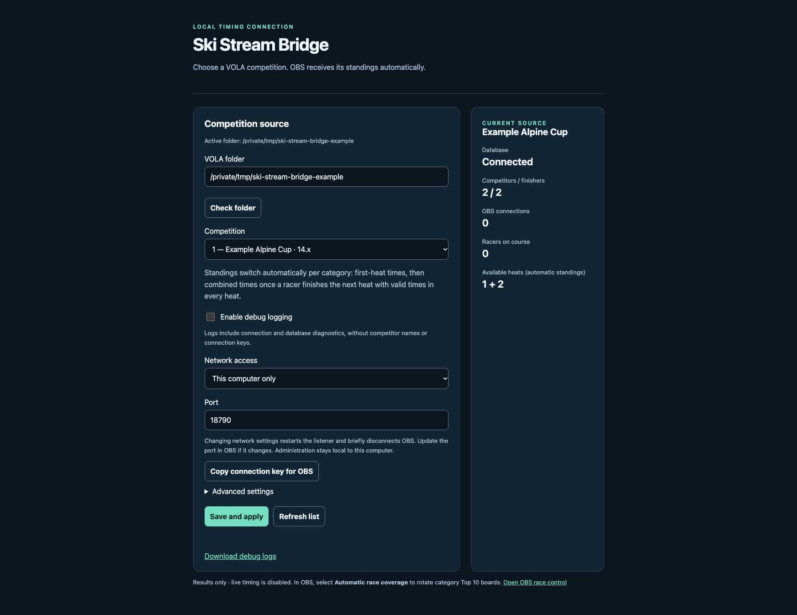

# Ski Stream Bridge

Read VOLA SkiAlp-Pro SQLite databases and send competitor details and results to Ski Stream Overlay over WebSocket. Run the bridge on the timing PC; run OBS and the overlay plugin on the streaming Mac. The PCs must be reachable over the local network.

This version uses **Node.js 24**, a **JSON configuration file**, and **no Python**. It has a command-line interface and a local browser control page; an Electron window has not been implemented. Windows executable packaging is included but is **untested on Windows**.



The screenshot uses an isolated example on port 18790; the normal default is 8789.

## What works

- Read `EventNNN.scdb` and `EventNNNEx.scdb` without changing VOLA tables or adding triggers.
- Import bibs, names, categories, clubs and birth years. No separate CSV is needed.
- Select standings automatically per category: first-heat times until the first valid combined finish, then only racers with valid cumulative times. No operator needs to switch heats.
- Send one complete snapshot on connection, then only changed competition metadata, competitors and results, including deletions.
- Automatically reconnect through the OBS adapter. A missing revision requests a new snapshot.
- Keep the last valid results when the database cannot be read; mark the source stale.
- Export bounded diagnostic logs without connection keys, competitor names, bibs, database contents or local folder paths.

**Race automation is supported:** starts, independent running clocks, overlapping racers, finish/DNF/DSQ holds, latest-category standings and idle category rotation. The default configuration remains results-only. The full chain is tested with explicit simulated START records. Actual VOLA start-status codes and device clock semantics must still be validated on the timing PC before enabling live record mapping.

## Run from source

### Windows timing PC (source installation)

1. Install **Node.js 24 LTS, version 24.11.1 or later within v24**, from [nodejs.org](https://nodejs.org/en/download). Include npm in the installation. Install [Git for Windows](https://git-scm.com/downloads/win), or download and extract this repository's ZIP.
2. Open PowerShell in a writable project folder and run:

   ```powershell
   git clone https://github.com/ataskinen/ski-stream-bridge.git
   cd ski-stream-bridge
   node --version
   npm ci
   .\start-windows.cmd
   ```

   If you downloaded a ZIP, open PowerShell in the extracted folder and start at `node --version`. It must report `v24.x`. No Visual Studio, Python, Docker or OBS installation is needed on the timing PC.
3. Keep the terminal open. Open **http://127.0.0.1:8789/** in a browser on that PC.
4. Enter the absolute **VOLA folder** containing both `EventNNN.scdb` and `EventNNNEx.scdb`. Click **Check folder**, then select the competition.
5. For OBS on another computer, choose **Local network**. Keep port **8789** unless it conflicts with another service. Click **Save and apply**. If Windows Firewall prompts, allow the bridge/Node on the **Private** network only. Both computers must be on a trusted network that permits communication between devices.
6. Click **Copy connection key for OBS** and follow [Connect OBS](#connect-obs) below. Find the timing PC's IPv4 address with `ipconfig`; use that address in OBS. The administration page itself remains available only on the timing PC.

The first launch creates a private `config.json`, connection key and log directory. You do not need to edit JSON. Setup remains reachable before a valid VOLA folder is selected. Source installation and EXE packaging are **not yet verified on Windows**; test on the timing PC before the race.

### macOS (local testing)

Install Node.js 24 LTS and Git, then:

```sh
git clone https://github.com/ataskinen/ski-stream-bridge.git
cd ski-stream-bridge
node --version
npm ci
bash start-mac.sh
```

Open **http://127.0.0.1:8789/** and select your local VOLA folder and competition. Choose **This computer only** when OBS runs on the same Mac; use `127.0.0.1:8789` in OBS. No archive or competitor data is included in this repository. Supply your own authorized database pair. Tests generate small synthetic databases with fictional participants.

### Starting, stopping and updating

After the initial installation, start Windows with `start-windows.cmd` or macOS with `bash start-mac.sh`. Keep the bridge running throughout the race; closing the terminal stops it. **Ctrl+C** shuts it down cleanly. This version does not install a background service or start automatically at login.

To update, stop the bridge, run `git pull --ff-only` and `npm ci` in its folder, then start it again. Ignored `config.json` and `local/` files preserve your settings and key. Do not copy live databases or private configuration into Git. Port changes also require updating OBS's bridge port.

If the page does not open, read the terminal error and check the configured port. If no competitions appear, verify the folder contains both readable database files. If OBS cannot connect, check **Local network**, the IP address, port, shared key and the timing PC's firewall. A Wi-Fi guest network can prevent the computers from communicating. Live starts require separate validation of the mapping described below; results-only mode does not provide running clocks.

### Configuration reference

You can also copy `config.example.json` to `config.json`. The equivalent configuration is:

```json
{
  "folder": "C:/VOLA/Events",
  "event": 3,
  "autoStandings": true,
  "bind": "0.0.0.0",
  "port": 8789,
  "pollIntervalMs": 250,
  "reconcileIntervalMs": 5000,
  "keyFile": "local/connection-key",
  "debug": true,
  "logDirectory": "local/logs"
}
```

Use the folder containing the `.scdb` files directly. Event 3 means `Event003.scdb` and `Event003Ex.scdb`; the number matches VOLA's event selection. Keep the pair together. Use forward slashes in Windows JSON paths, or escape backslashes as `\\`.

| Setting | Meaning |
| --- | --- |
| `folder` | VOLA database folder on the timing PC |
| `event` | Event number, not a competitor number |
| `autoStandings` | Defaults to `true`; discover all heats and select standings per category |
| `heats` | Advanced manual override only with `autoStandings: false`; also retains the initial timing configuration anchor |
| `bind` | `127.0.0.1` for same-computer testing; `0.0.0.0` for LAN access |
| `port` | TCP listening port, normally `8789` |
| `pollIntervalMs` | Database check interval, minimum 100 ms |
| `reconcileIntervalMs` | Full selected-table comparison interval, minimum 1000 ms |
| `keyFile` | Generated shared connection key; keep private |
| `debug` | Enable detailed polling diagnostics |
| `logDirectory` | Local rotating logs |

Relative JSON paths resolve against the configuration file's directory. Browser folder fields use absolute paths. Restart the bridge after manually editing JSON; browser changes are saved and applied immediately.

```sh
node src/cli.cjs --config config.json --list
node src/cli.cjs --config config.json
```

On the development Mac, `./start-mac.sh --debug` uses the private Node 24 runtime when present. To export logs: `./start-mac.sh --export-logs diagnostics.json.gz`. On Windows, `start-windows.cmd --debug` starts the EXE when present, otherwise the source version (Node 24 and `npm ci` required).

`--list` prints available competitions and heats, then exits. Ctrl+C stops the bridge and closes its database connections. Node 24 may print an experimental SQLite warning; the dependency and behavior are covered by the tests below.

## Choose a competition on screen

Open `http://127.0.0.1:8789/` on the computer running the bridge (use your configured port if different).

- **VOLA folder** accepts the absolute path on the timing computer. **Check folder** discovers readable database pairs without changing the active source.
- **Competition** lists the events found in the configured folder, using VOLA's event number and title.
- **Standings are automatic.** Each category shows first-heat times until a racer has valid times in both heats. It then shows combined times only for racers with valid times in both. Other categories keep their first-heat results. The same rule extends to later heats. DNS/DNF/DSQ never trigger the switch and never receive a ranked place. If corrections remove every valid combined finish, that category returns to the previous heat. The state is reconstructed after a restart.
- **Save and apply** validates the database pair and all settings, saves them to `config.json`, and sends a fresh snapshot to OBS. If validation or saving fails, the previous source remains active.
- **Network access** selects this computer only or the local network. **Port** sets the listening port. Saving changes restarts the listener, briefly disconnects OBS, and shows the new local control URL. Update the port in OBS if it changed. Occupied ports are rejected; the previous listener is restored if saving fails.
- **Copy connection key for OBS** copies the existing key only after an explicit button click. The key is never part of normal settings responses or diagnostic logs. Browser clipboard permission may be required.
- **Advanced settings** includes polling and full comparison intervals, the log folder, and timing mode/date/UTC offset/accepted start codes. These live mappings still require validation against real VOLA.
- **Enable debug logging** is saved with the selection.
- **Download debug logs** exports the same safe `.json.gz` diagnostics as the CLI.
- The status card shows the active event, database health, competitor/finisher counts and OBS connections. Choosing an event with no finish times correctly produces empty standings.

Control is restricted to localhost, including when the data endpoint listens on the LAN. Mutations require a per-process control token and same-origin requests. There is no remote administration access. All editable settings are persisted in the configuration file. The private key file path stays an advanced JSON-only setting; the UI copies the existing key rather than rotating it.

## Connect OBS

Install [Ski Stream Overlay](https://github.com/ataskinen/ski-stream-overlay) on the streaming computer using its README. Use a Ski Stream Overlay build containing **VOLA SQLite Bridge** support. Older plugin builds only support TCP timing messages and cannot consume this endpoint.

1. Start the bridge on the timing PC.
2. Open OBS race control at `http://127.0.0.1:8787` on the streaming computer.
3. Choose **VOLA SQLite Bridge** as the data source.
4. Enter the timing PC's IP address and port `8789`. Use `127.0.0.1` only when both applications run on the same computer; do not enter `0.0.0.0` as a destination.
5. Click **Copy connection key for OBS** on the bridge page and paste it into **Bridge connection key**.
6. Enable **Testisyöte** for an archive/demo; save and connect.
7. Add the native **Ski Race Overlay** source and select **Automatic race coverage**. Put video underneath it.

A results-only initial snapshot starts category rotation immediately. A timing snapshot restores racers already on course without replaying historical finishes. New starts interrupt category rotation; Top 10 never covers active racers. Finish, DNF and DSQ use the overlay's configurable hold duration. After the course clears, the last finisher's category is shown until the configured idle threshold triggers rotation. The overlay's category display duration controls the interval, normally 10 seconds. Only categories with ranked finishes are cycled. Top 10 ranks are calculated within each category, with gaps to its leader. Competition name comes from VOLA; discipline remains an overlay setting.

Allow inbound TCP on the chosen port in the timing PC's Windows Firewall for the private network only. This version uses unencrypted `ws://` and a shared key: use a trusted LAN, not port forwarding to the internet. The bridge rejects browser-origin WebSocket connections. Its HTTP snapshot and health endpoints also require the key.

## Debug logs for a test session

Set `"debug": true` in the config, or override it for one run:

```sh
node src/cli.cjs --config config.json --debug
```

In another terminal (or after stopping the bridge), export the latest logs:

```sh
node src/cli.cjs --config config.json --export-logs diagnostics.json.gz
```

For the packaged Windows application:

```powershell
.\SkiStreamBridge.exe --config config.json --debug
.\SkiStreamBridge.exe --config config.json --export-logs diagnostics.json.gz
```

The `.json.gz` file contains readable JSON compressed with gzip. It records timestamps, runtime/platform, selected event number and heat count, connection events, revision numbers, delta sizes, table-read counts and polling durations. Read failures use safe reason codes (such as `missing-table`, `database-busy` or `access-denied`) and SQLite numeric error codes when available. It never includes raw exception messages, headers, database rows or a copy of the configuration. Logging uses a field allowlist, tested against accidental payload/secret inclusion.

Normal mode still records lifecycle events, changes and errors. Debug mode adds each poll. Logs rotate at roughly 2 MiB per file, retaining the current file and three backups. Export includes only those four known log files, not arbitrary files from the directory. Logs and exports are ignored by Git. If the log directory becomes unwritable, the bridge reports it to the terminal and keeps processing results.

## Build a Windows EXE — untested

On Windows, install Node.js 24 LTS for the target architecture. Visual Studio and Python are not required by this project; SQLite is built into Node.

```powershell
powershell -ExecutionPolicy Bypass -File scripts/build-windows.ps1
```

The script installs locked dependencies, runs tests, bundles the application and injects it into the Node executable using Node's Single Executable Applications mechanism. Output: `dist/SkiStreamBridge.exe`. The generated package also contains example configuration and license notices. Start the EXE and configure its VOLA folder and competition in the local browser page.

The EXE uses `config.json` beside the executable by default. An explicit `--config` path overrides this. It opens a console, not an Electron window. Its configuration, key and logs remain outside the executable so they survive updates. The executable is unsigned. Test both the EXE and firewall setup on the actual timing PC before the race; the Mac test run does not establish Windows compatibility.

## Full timing simulation and live mapping

To simulate starts and finishes using a private archive copy, first run the preparation command in the next section, then:

```sh
node scripts/live-replay.cjs --folder local/replay-demo --heat 1 --demo-order
```

This resets the copied result and START/FINISH record tables and writes a simulation timing configuration into that copy's `config.json`. **Start/restart the bridge with this generated config after launching the writer.** The writer starts paused. In the local browser control page, **Start / resume**, **Pause starts**, **Next racer** and **Reset simulation** send commands to this separate writer. These controls appear only for simulation mode; they cannot write to a real timing source. The same commands remain available in the writer terminal. `resume` allows automatic starts every five seconds, up to three simultaneous racers; `pause` stops new starts while active racers finish; `next` starts one racer; `reset` empties the copied race and pauses starts; `quit` stops the writer. Run only one writer per copy.

Normal finishers run for their archived heat time and finish with that exact time. Archived DNF/DSQ statuses arrive after 15 simulated seconds; DNS racers never start. `--demo-order` puts three normal finishers, a DNF and a DSQ first so the main transitions can be checked quickly; remaining racers follow the archive queue. After each heat, a ten-second results break precedes the next archived heat automatically. Each heat uses its own start-list order, with remaining recorded results appended. Earlier heat results remain in place, and each category switches to cumulative standings when its first valid combined finish arrives. After the final heat, starts stop and category results continue rotating. Reset clears every heat and returns to the initial heat. The bridge must remain available on its configured local port for heat changes; a failed change pauses starts until you resume. This synthesizes start spacing rather than reproducing the original chronology.

The simulator writes status `0` START rows with `C_HOUR2` as microseconds since local midnight. This is an **explicit synthetic mapping**, not evidence that current VOLA uses that status for every valid start.

The optional `timing` configuration enables the same reader on an actual timing database:

```json
"timing": {
  "mode": "records",
  "heat": 1,
  "date": "2026-11-24",
  "utcOffsetMinutes": 120,
  "startStatuses": [0]
}
```

Treat the example status as a placeholder until verified by the timing operator. `mode: "off"` (or omitting timing) disables start reading; `mode: "simulation"` labels the synthetic adapter. With automatic standings, the bridge inspects available START tables for every heat and uses each racer’s latest heat; no heat change is required during the race. The configured timing heat remains an initial anchor. In advanced manual mode it must be the last selected heat. The date and UTC offset must match the timing device, including daylight-saving time; update them if the race crosses a date boundary. This adapter does not infer midnight rollover or device clock corrections.

Only explicitly accepted START statuses are read. `C_HOUR2` supplies the start clock; configured date/offset convert it to an absolute timestamp. A positive normal result or DNS/DNF/DSQ in the active heat removes that racer from the course. An absent result never automatically becomes DNF. Later corrections update standings. Clearing a previous run's result before restarting its bib is required. Unknown statuses are not guessed.

Snapshots include active racers and start anchors, so reconnecting restores current clocks without replaying old finishes. WebSocket frames contain the bridge clock; the OBS service uses it to align start timestamps to its local clock. Clocks are estimates between packets, freeze when the source is stale, and resume on a healthy state. Source/device clock offset still requires validation with VOLA. Selecting another competition disables the configured timing adapter until explicitly reconfigured.

## Replay an archived competition into a test database

The replay tool creates a **new private copy**, clears only the result tables used by this bridge, and restores one competitor's archived result rows at each step. Source files are opened read-only and copied with SQLite backup. An existing output folder is rejected. Other archived tables remain in the copy; this is a results-feed test, not a simulation of VOLA's timing logs or live starts.

Prepare an empty copy while the original bridge can still run:

```sh
node scripts/replay.cjs --source-config config.json --event 3 --folder local/replay-demo --prepare-only
```

Stop the original bridge, then point it at the generated replay configuration:

```sh
node src/cli.cjs --config local/replay-demo/config.json --debug
```

In another terminal, start the writer:

```sh
node scripts/replay.cjs --folder local/replay-demo --interval-ms 3000 --paused
```

The writer accepts `resume`, `pause`, `next`, `reset` and `quit` followed by Enter. `reset` clears the copied result tables and pauses the writer. Use `resume` to start again. `quit` stops the writer; final results remain available to the bridge. Run one writer per replay copy. To return to the original archives, stop the replay bridge and restart with the original `config.json`.

Rows follow the first heat's start-list order when that table exists, with remaining result bibs appended. Each step restores **all archived heat rows for one bib in one transaction**, including DNS/DNF/DSQ, and increments the corresponding `TUPDATEVALUES` counters. With total standings selected, that competitor's final total appears immediately. This deliberately compresses a multi-heat competition; it does not reproduce the real chronological progression of heat 1 and heat 2.

Keep OBS's **Testisyöte** option enabled. Names and result rows in `replay-plan.json` are private data and belong only in ignored `local/` folders. The bridge remains read-only; only the separate replay writer changes its newly created copy.

## Validation and limits

```sh
npm test
npm run build:bundle
node build/bridge.cjs --help
```

Tests create synthetic databases and cover read-only behavior, corrections/deletions, counter fallback, publication exclusions, unknown statuses, reconnect/resync, failure retention, key persistence and log privacy/rotation/export.

The reader uses `PRAGMA data_version` and VOLA's table-level `TUPDATEVALUES` counters to avoid unnecessary table reads. It compares rows in memory and sends only changes. A periodic full reconciliation catches edits that do not update those counters. Two files cannot provide an atomic view of independent VOLA commits: concurrent changes are checked and retried, but live testing remains necessary.

Validated result interpretation: `C_TIME` in milliseconds; `C_STATUS` 0 normal, 1 DNS, 2 DNF, 3 DSQ. Nonzero penalties and unknown statuses are excluded with warnings rather than ranked using guesses. Nonzero `C_RGPD_DONOTPUBLISH` excludes the competitor and results. Duplicate bibs reject the update. Special race formats and penalty semantics require separate validation.

The supplied archives include metadata versions 12.1.05 and 14.1.04. Compatibility with an actively running 14.1.08 has not yet been established. Keep actual archives, connection keys, settings and exports in ignored local folders. Never commit them.

## Credits and protocol

The schema investigation was informed by [Kiril's original overlay](https://github.com/jovchev/vola-skialppro-text-overlay) and [VOLA poorman publish](https://github.com/jovchev/vola-poorman-publish). This bridge is a separate implementation and does not use the old timing socket. It is not an official VOLA product.

See [PROTOCOL.md](PROTOCOL.md) for the WebSocket contract. The implementation uses [Node SQLite](https://nodejs.org/docs/latest-v24.x/api/sqlite.html), [Node SEA](https://nodejs.org/docs/latest-v24.x/api/single-executable-applications.html) and the `ws` package.

## Publication and privacy

The repository contains source, documentation, a reviewed UI screenshot, example configuration and synthetic tests only. `publication-files.json` is the exact publishable file list. Before committing, stage only those files and run `npm run check:publication`; it rejects extra tracked files, database/archive formats, binary content, personal paths and recognized credential tokens. Never force-add `local/`, private configs, competitor exports or VOLA database copies. The same check runs in CI.

Licensed under GPL-2.0-only; see [LICENSE](LICENSE).
